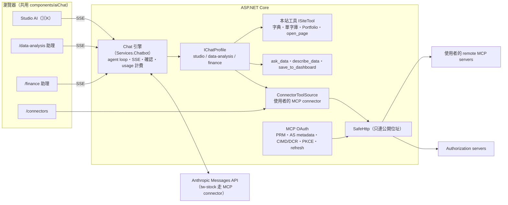

# Studio AI — 成果發表（11/5）

> **初稿（2026-10-24 第 6 輪）**。功能還在擴充，階段 2（11/4–11/5）定稿並補齊截圖與統計。故事線的來源是 [design/02](design/02-vision-and-showcase.md)。

**一句話：一個在每一頁都叫得出來的 AI 助理，會用本站自己的功能，也能接上你在外面的任何 remote MCP server（含 OAuth 登入），而且會改變東西的動作一定先問你。**

## 功能與亮點

| 你看到的 | 背後 | 為什麼跟上 2026 的趨勢 |
|---|---|---|
| **Studio AI**：任何頁面右下角按鈕或 ⌘K／Ctrl+K 叫出，知道你在哪一頁 | 共用 chat 引擎的 `studio` profile；本站功能都是工具（`ISiteTool`） | 「網站本身就是工具」：同一個 AI 到處都在 |
| 「查 serendipity，加入我的單字庫」→ 單字卡 → **確認卡** → 加入 | `look_up_word`（讀）、`add_word_to_repository`（寫，先確認） | Agent 會動手，所以 human-in-the-loop |
| 「我的投資組合現在怎麼樣？」→ **持倉表格卡片** + 重點分析 | `portfolio_summary`，照 /portfolio 的估值 | 結果是 UI，不是一坨文字（generative UI） |
| /data-analysis 最上方的 AI 對話：問問題 → **互動圖表** → 「存到業績追蹤 dashboard」→ 確認 → 完成 | `ask_data`（沿用 問 AI 的檢查過的查詢管線）、`describe_data`、`save_to_dashboard` | AI 只用經過驗證的查詢，不自己寫 SQL |
| **Connectors**：目錄一鍵加入 tw-stock、DeepWiki；貼任何 MCP URL 自動偵測登入方式 | MCP 官方 SDK（Streamable HTTP）、SafeHttp 防 SSRF | MCP 是 AI 接工具的標準 |
| 需要登入的 MCP server：**自動跑完 MCP 授權規格** | 401 → PRM（RFC 9728）→ AS metadata（RFC 8414／OIDC）→ DCR／CIMD／手填 client → PKCE S256 + `resource` + `iss` → token 加密 → 到期自動 refresh | 2025-11 起的 MCP 授權規格（PRM、CIMD、RFC 8707 resource、RFC 9207 iss） |
| 每個工具「自動／需確認／停用」；讀過外部資料後的寫入一律先問 | `ToolPermissions`、taint（D-031）、工具結果包成不可信資料 | prompt injection 防護 |
| /finance 的 Stock Intelligence：**行為不變** | 同一套共用 chat（`FinanceChatRequestTests` 逐欄位鎖住） | — |

## Demo 腳本（約 8 分鐘）

前置：production（或本機）已有 `Settings:AnthropicApiKey`；用一般帳號登入；Portfolio 有一份快照；/data-analysis 的預設資料源可用（見 FOR_JACKY 2）。

1. **開場（30 秒）**：首頁 → 按 ⌘K → 右側滑出 Studio AI，建議問題依目前頁面變化。
   
2. **本站即工具（1 分鐘）**：輸入「serendipity 是什麼？幫我加入單字庫」→ 回答上方顯示用了「查字典」→ 單字連結卡 → 出現**確認卡**「加入單字庫：serendipity」→ 按「允許」→「已加入」與「前往單字庫」。
   
3. **我的資產（1 分鐘）**：到 /portfolio → ⌘K →「幫我看看我的持股，哪幾檔虧最多？」→ 持倉表格卡片 + 重點。
   
4. **資料 → 圖表 → dashboard（2 分鐘）**：/data-analysis → 最上方對話框「畫出各地區每月營收，存到『業績追蹤』dashboard」→ 圖表卡片 → 確認卡「存到 dashboard」→ 允許 → 點連結卡打開 dashboard，看到同一張圖（之後會用最新資料重畫）。
   
5. **接上外面的世界（2 分鐘）**：/connectors → 目錄裡的 Notion 或 Linear 按「前往授權」→ 用自己的帳號登入 → 回到 /connectors 顯示已連線與工具 → Studio 問「我在 Linear 上還有哪些未完成的 issue？」。或一鍵加入 DeepWiki → 回到 Studio 問「twjackysu/JackyAIApp 這個 repo 的架構是什麼？」→ 工具進度顯示「DeepWiki・…」→ 回答。再示範「新增 MCP server」：貼一個需要 OAuth 的 MCP URL → 「找到了！這個 server 用 OAuth 登入（xxx）」→ 前往授權 → 回來後工具列表出現。
   
   
6. **安全（1 分鐘）**：在 connector 詳情把某個工具設成「停用」→ AI 說它沒有這個能力；「需確認」的工具一律出確認卡；按「停止」整輪什麼都不執行。
7. **Stock Intelligence（30 秒）**：/finance 問一檔股票，跟以前一樣。
8. **收尾**：下面的架構圖，以及「新增一個 connector 要寫多少 code」（[CONTRIBUTING-CONNECTORS.md](CONTRIBUTING-CONNECTORS.md)）。

## 架構

- **設計模式**：一個 chat 引擎 + 每個 app 一個 profile（system prompt、工具、page context）；工具一律是 `IAiTool`（描述 + `RunAsync`），本站功能、Data Analysis、外部 MCP 都一樣；工具結果是不可信資料，卡片是宣告式 JSON 由前端 renderer 畫。
- 新增 connector：見 [CONTRIBUTING-CONNECTORS.md](CONTRIBUTING-CONNECTORS.md)（remote MCP 只要一行目錄設定；本站功能實作一個 `ISiteTool`）。

## 合回 master 的檢查清單

- [ ] **不需要新的 secret**：Studio AI、Data Analysis 助理共用既有的 `Settings:AnthropicApiKey`；MCP token 用既有的 `TokenEncryption:Key` 加密。
- [ ] **MCP OAuth 的網址**（不用註冊 OAuth app，是給外部授權伺服器看的）：redirect URI `https://apps.jacky-studio.com/api/connectors/callback/mcp`、client metadata `https://apps.jacky-studio.com/api/connectors/oauth/client-metadata`，都由既有的 `Connectors__CallbackBaseUrl` 推出來，不用新設定。
- [ ] **EF migration**（production 啟動時執行，只新增、不動既有資料）：`20261024100000_AddChatProfileAndCards`（`ChatConversations.Profile` 預設 finance、`ChatMessages.CardsJson`）、`20261024120000_AddConnectorInstallations`（新表）。
- [ ] 刪除 `.github/workflows/ai-native-ci.yml`、`.loop/`。
- [ ] 合併後會自動部署到 production（Build and deploy）。
- [ ] 用量：AI 對話照既有每日預算計費（每則訊息 `UsageCosts.ForChatMessage`、`ask_data` 照 問 AI）。

## 本機試跑

1. 後端：`JackyAIApp.Server` 的 `appsettings.Development.json` 填 `Settings:AnthropicApiKey`、`TokenEncryption:Key`（64 bytes base64），`dotnet run`。
2. 前端：`jackyaiapp.client` 的 `npm run dev`，開 https://localhost:5173，登入。
3. 本機的 client metadata URL 是 localhost，外部授權伺服器讀不到，所以 OAuth 會改走 DCR 或手填 client（`McpOAuthUrls`）。

## 已知限制與後續

- 確認流程在同一個請求裡等待：重新整理頁面會失去待確認的問題（D-026）。
- MCP client 只支援 Streamable HTTP（不支援舊 SSE transport，D-029）；每次請求一個 session。
- MCP OAuth 的 step-up（403 insufficient_scope 重新授權）尚未做。
- taint 只算一輪（D-031）。
- 延伸：MCP Apps（工具回傳互動 UI）、本站對外提供 MCP server。

## 開發日誌與統計

（階段 2 填入最終數字）

| 日期 | 輪 | 重點 |
|---|---|---|
| 10/24 | 1 | 研究、設計定稿、M1 起步（golden test、SSE 修正、SafeHttp） |
| 10/24 | 2 | 共用 chat profile、前端 config 化、ToolActivity／ApprovalCard |
| 10/24 | 3 | /connectors v2 前端、工具結果卡片 |
| 10/24 | 4 | agent loop、Data Analysis 助理、離線型別檢查 |
| 10/24 | 5 | 同請求確認、connector 後端、自己的 MCP server、Studio AI |
| 10/24 | 6 | MCP OAuth、Portfolio 工具、用說的存 dashboard、本頁初稿 |

截至第 6 輪：feature/ai-native 比 master 多 60+ 個 commit（不含 merge）。
