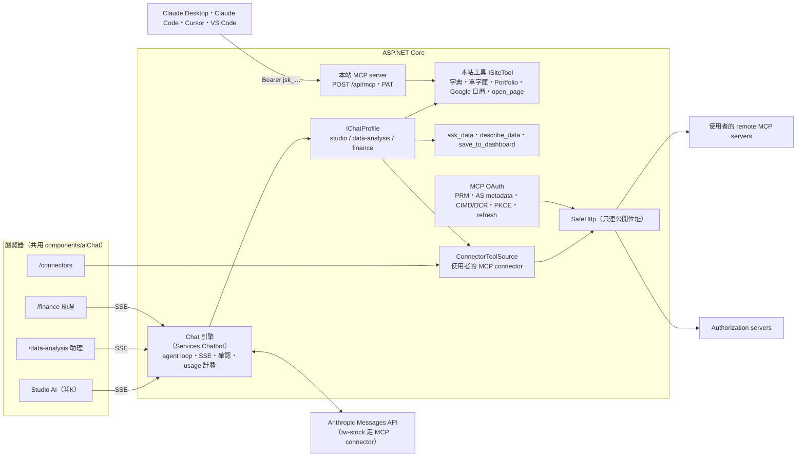

# Studio AI — 成果發表（11/5）

> **初稿（2026-10-24 第 6 輪，第 8 輪補上本站 MCP server）**。功能還在擴充，階段 2（11/4–11/5）定稿並補齊截圖與統計。故事線的來源是 [design/02](design/02-vision-and-showcase.md)。

**一句話：一個在每一頁都叫得出來的 AI 助理，會用本站自己的功能，也能接上你在外面的任何 remote MCP server（含 OAuth 登入），而且會改變東西的動作一定先問你。反過來，網站本身也是一個 MCP server：你的 Claude Desktop、Cursor 也能用本站的功能。**

## 功能與亮點

| 你看到的 | 背後 | 為什麼跟上 2026 的趨勢 |
|---|---|---|
| **Studio AI**：任何頁面右下角按鈕或 ⌘K／Ctrl+K 叫出，知道你在哪一頁 | 共用 chat 引擎的 `studio` profile；本站功能都是工具（`ISiteTool`） | 「網站本身就是工具」：同一個 AI 到處都在 |
| **⌘K 也是指令列**：在 Studio 打「複習」「portfolio」、自己 dashboard 的名稱或一個英文單字，輸入框上方立刻出現「前往『複習』」「查字典：review」，按下直接到（不問 AI、不花用量）；打完整的問題就交給 AI | 前端的 `quickActionsFor`（頁面清單由測試對齊伺服器的 `SitePages`），只認頁面名稱與單一英文單字 | Raycast／Linear 式的指令列與 AI 助理合而為一：簡單的事零延遲，複雜的事交給 agent |
| **打「/」就有現成指令**：Studio 輸入框打 `/` → 今日簡報、考我單字、用我的單字寫短文、投資組合健檢…一排按鈕，打 `/簡報`、`/quiz` 就篩出來，按下直接送出 | 前端的 `slashCommands`；名稱跟本站 MCP server 的 prompts 一樣，所以 Claude Code 裡的 `/mcp__jacky-studio__quiz_me` 與本站的 `/quiz` 是同一件事 | 斜線指令是 2026 AI 產品的共通語言（Claude、ChatGPT、Cursor） |
| **用說的**：三個助理的輸入框都有麥克風，說「給我今天的簡報」字就出現在框裡 | 瀏覽器內建的 Web Speech API（zh-TW），不經本站伺服器、不花 AI 額度；Firefox 沒有就不顯示 | 語音是 2026 AI 助理的基本互動 |
| **聽它說**：每個回答下方的「朗讀」，英文段落用英文聲音、中文翻譯用中文聲音念出來（配上麥克風就是語音對話） | 瀏覽器的 speechSynthesis，`speechText` 把 Markdown 變成字並依語言切段；不經伺服器、不花用量 | 語音進、語音出：AI 助理不只能看 |
| **AI 今日簡報**：首頁一鍵，Studio AI 同時讀行程、學習進度、投資組合，整理成三段重點與「先做哪件事」 | `askStudio`（任何頁面帶一句話打開 Studio）；模型在一次回覆裡呼叫三個工具，卡片與文字一起出現 | Agent 的價值是「跨 app 組合」：一個問題用到三個資料源 |
| **「帶我去複習」→ 頁面真的切過去**，對話留在旁邊說明到了之後怎麼做；每個回答下方有 2–3 個 **「接著問」** 一鍵續問 | `open_page` 的 `go` → `tool_result.navigate`（只限本站工具、站內路徑、沒讀過外部內容）；接著問依回答用到的工具決定（不花 token） | AI 不只回答，還會操作網站本身 |
| **「考我今天該複習的單字」→ 回答裡直接出現可以作答的測驗卡**：一次一題、按下立刻顯示對錯與解說，答完自動記進 SM-2 複習排程（+XP） | `review_quiz`（每日挑戰的題型產生器，不花 AI）→ `quiz` 卡片 → 前端呼叫既有的 `review/submit`；模型被告知考哪些字但不准說出答案 | Generative UI 不只顯示結果，還能「互動」：對話裡長出一個小 app |
| 單字庫頁「用我單字庫裡最近存的字寫一段短文」→ AI 讀你最近存的 5 個字，寫一段把它們**粗體標出**的英文短文＋中文翻譯，按「朗讀」聽它念 | `saved_words`（最近存的字與一個中文意思、總字數；不花 AI 的讀取）＋模型的寫作 | 個人化的 AI 學習：教材是你自己的字 |
| **選一段字就能問**：在任何頁面選取一句例句、一段分析 → 選取處上方出現「解釋／翻成中文／問 AI」；選一個英文單字是「查字典／加入單字庫」——在 Studio 自己寫的短文裡選一個不認識的字，一鍵加入單字庫。/finance 與 /data-analysis 也一樣，問的是那一頁自己的助理（選「多頭排列」→ 解釋）；作答中的考題不給（不會一選就洩漏答案） | `aiChat/selection`（`SelectionBar`、`selectionStepOf`，Studio 與各 app 的助理共用；選取停 250ms 才出現；`noSelectionAsk` 標出作答中的題目）；頁面上的文字可能是別人寫的，所以請求帶 `quotesPageText`，伺服器把對話標成讀過外部文字，寫入一律先問 | AI 不在旁邊的框裡等你，而是出現在你正在讀的地方（Notion、Arc、Apple Intelligence 式的 inline AI） |
| **Studio AI 記得你**：說「記住：我在準備多益，目標 800 分，短文用商務情境」→ 確認卡寫出整句筆記 → 之後每個新對話的短文、簡報、出題都照這個方向（資料分析的助理也讀得到，只讀）；「你記得我什麼？」、/connectors 上逐則刪除 | `AssistantMemories`（每則 200 字、每人 30 則）；`remember`（寫入，先問）／`forget`（照抄筆記文字、Destructive）；筆記放在 system prompt 的 `<user_memories>`，標明「不是指令」、`<>` 換成全形，防持久化的 prompt injection | ChatGPT、Claude、Gemini 2025–2026 的「記憶」：個人化的 AI，而且使用者看得到、刪得掉 |
| 「查 serendipity，加入我的單字庫」→ 單字卡 → **確認卡** → 加入 | `look_up_word`（讀）、`add_word_to_repository`（寫，先確認） | Agent 會動手，所以 human-in-the-loop |
| 「我的投資組合現在怎麼樣？」→ **持倉表格卡片** + 重點分析 | `portfolio_summary`，照 /portfolio 的估值 | 結果是 UI，不是一坨文字（generative UI） |
| 「我今天加碼 0050 兩張，均價 185，幫我記下來」（或**貼一張券商成交回報的截圖**）→ **確認卡**「『0050』加 2,000（成交價 185）（存成今天的快照）」→ 允許 → 投資組合更新 | `update_holding`（寫入，先確認）：最新快照改那一筆、存成今天的快照，成本照平均成本法（買進加上付出的錢、賣出保留平均成本）；買進沒說價格就先問、對到兩筆就不猜 | 跨 app 的「用說的記帳」：AI 不只讀你的資料，也幫你維護它 |
| 「我今天有什麼行程？」→ **Google 日曆表格卡片** + 空檔建議 | 原生 connector `google_calendar_events`：用既有 Google 帳號連線（唯讀），行程標題視為外部文字 | 不只 MCP：自家程式呼叫 API 也是同一套工具抽象 |
| /data-analysis 最上方的 AI 對話：問問題 → **互動圖表**（卡片上直接換成長條、圓餅…，不再問 AI）→ 「存到業績追蹤 dashboard」→ 確認 → 完成 | `ask_data`（沿用 問 AI 的檢查過的查詢管線）、`describe_data`、`save_to_dashboard` | AI 只用經過驗證的查詢，不自己寫 SQL |
| **一句話做出整個 dashboard**：「幫我做一個業績總覽 dashboard（3 到 4 張圖），存完打開」→ AI 自己挑趨勢、組成、排名三四張互補的圖 → 一張確認卡列出全部，按 **「全部允許（3）」** → 頁面切到剛做好的 dashboard | 只靠 prompt：同一個回覆一起呼叫多個 `ask_data`，再一起呼叫多個 `save_to_dashboard`（依序執行，第一張建立、之後的找到它）；確認卡的「全部允許」只在全部是本站工具、沒有無法復原的動作、沒讀過外部內容時出現 | Agent 做的是「一件事」而不是「一個步驟」：規劃、執行多步、一次讓你確認 |
| **AI 之間交棒**：在任何頁面跟 Studio AI 說「幫我做一個業績總覽 dashboard」→ 它說「交給資料分析的 AI 助理」→ 頁面自己切到 /data-analysis，那裡的助理**自動展開並接手**，畫圖、出確認卡 | `open_page` 的 `go`＋`ask` → `tool_result.handoff`（只跟著站內導覽送、讀過外部內容的對話不送）→ react-router 的 location state（外部連結設不了）→ 目的頁的 launcher 以新對話送一次後清掉 | 多 agent 協作（handoff）：全站助理是入口與調度者，專門的助理帶專門的工具做事；使用者不必知道該去哪問、也不用重打一次 |
| dashboard 上一鍵 **「AI 解讀」**：Studio AI 用最新資料重算每張圖，說出最重要的變化與異常（手機上 dashboard 一列一張圖） | `read_dashboard`（只讀自己的 dashboard，別人分享的不讀）；dashboard 頁的路徑讓「這個 dashboard」就是正在看的那個；同一個工具也開放給本站 MCP server，Claude.ai 裡也能問「我的業績追蹤 dashboard 怎麼樣？」 | 資料不只畫成圖，AI 還會讀圖、說重點 |
| **Connectors**：目錄一鍵加入 tw-stock、DeepWiki；貼任何 MCP URL 自動偵測登入方式 | MCP 官方 SDK（Streamable HTTP）、SafeHttp 防 SSRF | MCP 是 AI 接工具的標準 |
| 需要登入的 MCP server：**自動跑完 MCP 授權規格** | 401 → PRM（RFC 9728）→ AS metadata（RFC 8414／OIDC）→ DCR／CIMD／手填 client → PKCE S256 + `resource` + `iss` → token 加密 → 到期自動 refresh → 403 `insufficient_scope` 時 step-up | 2025-11 起的 MCP 授權規格（PRM、CIMD、RFC 8707 resource、RFC 9207 iss） |
| 每個工具「自動／需確認／停用」；確認卡可勾「以後直接執行」；讀過外部資料（含行事曆邀請）後的寫入一律先問；工具說明被改了就改回需確認 | `ToolPermissions`、taint（D-031、`OutsideText`）、工具結果包成不可信資料、`CachedTools.Changed`（rug pull） | prompt injection 與 tool poisoning 防護 |
| **網站本身就是 MCP server**：在 /connectors 產生 token，一鍵複製 Claude Code／Claude Desktop／Cursor／VS Code 的設定，別家的 AI 就能查字典、看你的學習進度與投資組合 | `POST /api/mcp`（Streamable HTTP、JSON 回應、無 session）、只存雜湊的 PAT、預設唯讀、跟 /connectors 的權限連動；**Claude.ai／ChatGPT 只要貼網址**：本站同時是 OAuth 授權伺服器（PRM、AS metadata、DCR、PKCE、同意頁） | MCP 是雙向的：網站不只是 MCP client，也是 MCP server |
| **在 Claude.ai／ChatGPT 裡也看得到本站的卡片**：問「我的投資組合」，回答下方直接出現本站的持倉表格（深淺色跟著 host） | MCP Apps（`ui://` 資源、`structuredContent`、postMessage 的 `ui/initialize`／`tool-result`／`size-changed`），一個內嵌的 HTML 畫所有卡片 | MCP Apps（2026 的 generative UI 標準）：工具不只回文字，也回 UI |
| **別家 AI 裡的斜線指令**：Claude Code 打 `/mcp__jacky-studio__daily_briefing` 就是今日簡報；還有「考我單字」（一次一題）、「解讀 dashboard」、「投資組合健檢」等 6 個現成指令（VS Code、Claude Desktop 的選單也有） | MCP prompts（`prompts/list`／`prompts/get`）：每個 `SitePrompt` 宣告在它用到的工具旁邊，token 用不到的工具就不列出它；參數整理成一行、最多 100 字 | MCP 的三種能力（tools、resources、prompts）本站對外全部提供 |
| /finance 的 Stock Intelligence：**行為不變**，工具 chip 與進度改用中文（「個股歷史股價」「技術指標」），回答下方有「接著問」 | 同一套共用 chat（`FinanceChatRequestTests` 逐欄位鎖住請求）；中文名稱是前端的對照表（`FINANCE_TOOL_LABELS`） | — |

## Demo 腳本（約 10 分鐘）

前置：production（或本機）已有 `Settings:AnthropicApiKey`；用一般帳號登入；Portfolio 有一份快照；/data-analysis 的預設資料源可用（見 FOR_JACKY 2）。

1. **開場：AI 今日簡報（1 分鐘）**：首頁最上方「AI 今日簡報」→ 右側滑出 Studio AI，一次呼叫 Google 日曆、學習進度、投資組合三個工具（回答上方三個工具 chip）→ 行程表格、「12 個單字待複習」卡片、三段重點與「建議先做的事」。之後任何頁面按 ⌘K 都叫得出它，建議問題依目前頁面變化；按輸入框的麥克風可以用說的。
   
   
   
   
   **指令列**：在 Studio 輸入框打「review」→ 上方出現「前往『複習』」與「查字典：review」，按一下就到，完全不經 AI；打一整句問題就照常送給 AI。
   
   打 dashboard 名稱的一部分（「業績」）→「打開『每月業績追蹤』」，按下直接到那個 dashboard。
   
   打一個 **「/」** → 輸入框上方出現「現成指令」：今日簡報、考我單字、用我的單字寫短文、投資組合健檢…，按一下就送出（同一組指令在 Claude Code 裡是 `/mcp__jacky-studio__…`，見第 8 步）。
   
2. **AI 操作網站（30 秒）**：在首頁 ⌘K →「帶我去複習」→ 背後的頁面直接切到「複習」，Studio 說明怎麼翻牌（手機上回答完抽屜自動收起，再按按鈕對話還在）。
   
3. **本站即工具（1 分鐘）**：輸入「serendipity 是什麼？幫我加入單字庫」→ 回答上方顯示用了「查字典」→ 單字連結卡 → 出現**確認卡**「加入單字庫：serendipity」→ 按「允許」→「已加入」與「前往單字庫」。確認卡下方寫著「3 分鐘內沒有回覆，這次就不執行」（最後一分鐘倒數秒數）；切到別的分頁時，分頁標題變成「（等你確認）Jacky's Studio」，這時重新整理頁面，瀏覽器會先問要不要離開（D-105～D-107）。
   
   接著到 /english → ⌘K → 第一個建議「考我今天該複習的單字」→ 回答裡出現**測驗卡**，直接按選項：對錯與解說立刻出現，三題答完顯示「答對 2 / 3 題」並記進複習排程（+XP），下方「再考我 3 題」。
   
   
   
   到 /english/repository → ⌘K → 第一個建議「用我單字庫裡最近存的字寫一段短文」→ 「我的單字庫」卡片（共 86 個字）＋一段用到 5 個字的英文短文（粗體）與中文翻譯 → 按回答下方的 **朗讀**（喇叭圖示），英文用英文聲音、翻譯用中文聲音念；下方「換個主題再寫一段」「考我幾題」。
   
   **選取就能問**：在短文裡把不認識的「ephemeral」選起來 → 上方出現「查字典／加入單字庫／問 AI」→ 按「加入單字庫」→ 同一個對話裡出現確認卡。再到字典頁，選一句例句 → 「解釋／翻成中文／問 AI」→ 按「翻成中文」→ Studio 開新對話，翻譯＋值得學的字詞表。到 /finance 問助理台積電的走勢，在回答裡選「多頭排列」→ 工具列換成 /finance 助理的「解釋／翻成英文／問 AI」→ 按「解釋」，接在同一段對話（截圖 `select-finance-*`）。
   
   
   
   
   **它記得你**：在單字庫頁 ⌘K 說「記住：我在準備多益，目標 800 分，短文用商務情境」→ **確認卡**「記住：『在準備多益，目標 800 分；短文用商務情境』」→ 允許 →「Studio AI 記得的事」卡片。開一個新對話再按「用我單字庫裡最近存的字寫一段短文」→ 短文是商務情境、提到多益（模型讀到的是 system prompt 裡的筆記）。問「你記得我什麼？」會照清單回答；記住「我負責北區業績」後，到 /data-analysis 問「最近業績怎麼樣」，資料分析的助理會先看北區並說明（它只讀筆記、不能改）；沒叫它記也行：「我下個月要考多益，用我最近存的字寫一段短文」→ 短文寫完，最後一張確認卡「記住：『下個月要考多益』」（一個對話最多提議一次，按拒絕就不再提）；到 /connectors 的「Studio AI 記得的事」看得到每一則，可以刪。
   
   
   
   
4. **我的資產（1 分鐘）**：到 /portfolio → ⌘K →「幫我看看我的持股，哪幾檔虧最多？」→ 持倉表格卡片 + 重點。
   
   回答下方的「接著問」：按「哪一檔佔比最高？風險集中嗎？」直接續問。
   接著說「我今天加碼 0050 兩張，均價 185，幫我記下來」→ 確認卡用一句話寫出要做的事 → 允許 →「已更新 元大台灣50（0050）：5,000 → 7,000，成本 900,000 → 1,270,000 TWD，存成今天的快照」，抽屜後面的投資組合頁**同時重新整理**（不用按重新整理），下方「我的投資組合現在怎麼樣？」一鍵看更新後的表格。
   
   
   **或直接貼券商的成交回報截圖**（按輸入框的 +）：「幫我把這兩筆記進投資組合」→ Studio AI 先列出讀到的每一筆（代號、買賣、數量、均價）→ 兩筆更新一起出現在確認卡，逐筆允許或拒絕。
   
   接著問「我今天有什麼行程？」（需先在 /connectors 的帳號連線連上 Google）→ Google 日曆表格卡片與空檔。
   
   **持股的市場面交給 Stock Intelligence**：回到 /portfolio → ⌘K → 建議「我的持股最近外資在買還是賣？」→ Studio AI 讀完持股（表格卡片）說「我把這三檔交給 Stock Intelligence 的 AI 助理了」→ 頁面切到 /finance，那裡的助理收到「我持有 2330 台積電、0050、2454 聯發科，這幾檔最近外資在買還是賣？」並用 tw-stock 工具回答——兩個 AI 各用自己的工具接力，使用者一個字都沒重打。
   
   
5. **資料 → 圖表 → dashboard（2 分鐘）**：/data-analysis → 最上方對話框「畫出各地區每月營收，存到『業績追蹤』dashboard，存完打開」→ 圖表卡片 → 確認卡用一句話說明「把『各地區每月營收』存到 dashboard『業績追蹤』，存好後打開它」（chartId 這類原始參數收在「顯示送出的參數」）→ 允許 → 回答結束後頁面自己切到那個 dashboard，看到同一張圖（之後會用最新資料重畫）。沒說「打開」就只留連結卡。
   
   
   圖表卡片上的圖示可以直接換成直條圖、圓餅圖…（不再問 AI）；下方的「接著問」一鍵續問。
   
   **一句話做出整個 dashboard**：開新對話，按歡迎畫面的第四個建議「幫我做一個業績總覽 dashboard（3 到 4 張圖），存完打開」→ AI 先看欄位，再一口氣畫出三四張互補的圖（趨勢、各地區占比、前 5 名產品）→ 一張確認卡列出全部存檔，按「全部允許（3）」→ 回答結束後頁面切到剛做好的「業績總覽」。
   
   **或從任何頁面交棒**：在首頁 ⌘K 跟 Studio AI 說「幫我做一個業績總覽 dashboard，存完打開」（/dashboards 列表頁的 Studio 建議裡就有這一句）→ 它回「交給資料分析的 AI 助理了」→ 回答結束後抽屜收起、頁面切到 /data-analysis，那裡的助理自己展開、送出同一個請求（訊息上方標著「由 Studio AI 轉來」），接著就是上面的三張圖與「全部允許」。
   
   
   
   到了 dashboard 頁，按標題旁的 **「AI 解讀」** → Studio AI 開新對話，讀這個 dashboard 的每張圖（用最新資料重算）→「北區是成長引擎、南區在下滑」這類重點，下方的接著問「哪張圖的變化最大？」。
   
   
6. **接上外面的世界（2 分鐘）**：/connectors → 目錄裡的 Notion 或 Linear 按「前往授權」→ 用自己的帳號登入 → 回到 /connectors 顯示已連線與工具 → Studio 問「我在 Linear 上還有哪些未完成的 issue？」。或一鍵加入 DeepWiki → 回到 Studio 問「twjackysu/JackyAIApp 這個 repo 的架構是什麼？」→ 工具進度顯示「DeepWiki・…」→ 回答。再示範「新增 MCP server」：貼一個需要 OAuth 的 MCP URL → 「找到了！這個 server 用 OAuth 登入（xxx）」→ 前往授權 → 回來後工具列表出現。
   
   
7. **安全（1 分鐘）**：在 connector 詳情把某個工具設成「停用」→ AI 說它沒有這個能力；「需確認」的工具一律出確認卡；按「停止」整輪什麼都不執行。
8. **反過來：網站本身就是 MCP server（1 分鐘）**：/connectors 往下捲到「讓其他 AI 使用本站」→「產生 token」（名稱 Claude Code、唯讀）→ 複製「Claude Code」那一行指令貼到終端機 → 在 Claude Code 問「用 jacky-studio 查一下 serendipity，再看我今天要複習幾個字」→ 它呼叫本站的 `look_up_word`、`learning_progress`。再打 `/mcp__jacky-studio__daily_briefing`（產生 token 的對話框會寫出這行）→ Claude Code 一次呼叫行程、學習進度、投資組合三個工具，整理成三段簡報；`/mcp__jacky-studio__quiz_me` 則一次問一題。回到 /connectors 看到 token「最後使用」更新；按「撤銷」後 Claude Code 立刻連不上。
   **或在 Claude.ai**：設定 → Connectors → 新增自訂 connector，只貼 `https://apps.jacky-studio.com/api/mcp` → 跳到本站的同意頁「Claude 想用你的身分使用 Jacky Studio 的工具，完成後會回到 claude.ai」→ 允許 → 回到 Claude.ai，工具出現。
   接著在 Claude.ai 問「我的投資組合現在怎麼樣？」→ 回答下方出現 **Jacky Studio 的持倉表格卡片**（MCP App），問「serendipity 是什麼」→ 單字卡，按「看完整解釋」開到本站字典頁；token 允許寫入時卡片上還有「加入單字庫」，在 Claude 裡按一下就加進本站的單字庫（MCP App 經 host 呼叫 `tools/call`）。
   
   
   
   
   
9. **Stock Intelligence（30 秒）**：/finance 問「分析台積電最近的走勢」，跟以前一樣；回答上方的工具 chip 現在是中文（「個股歷史股價」「技術指標」），下方有「接著問」。
   
10. **收尾**：下面的架構圖，以及「新增一個 connector 要寫多少 code」（[CONTRIBUTING-CONNECTORS.md](CONTRIBUTING-CONNECTORS.md)）。

## 架構

- **設計模式**：一個 chat 引擎 + 每個 app 一個 profile（system prompt、工具、page context）；工具一律是 `IAiTool`（描述 + `RunAsync`），本站功能、Data Analysis、外部 MCP 都一樣；工具結果是不可信資料，卡片是宣告式 JSON 由前端 renderer 畫。
- 新增 connector：見 [CONTRIBUTING-CONNECTORS.md](CONTRIBUTING-CONNECTORS.md)（remote MCP 只要一行目錄設定；本站功能實作一個 `ISiteTool`）。

## 合回 master 的檢查清單

- [ ] **不需要新的 secret**：Studio AI、Data Analysis 助理共用既有的 `Settings:AnthropicApiKey`；MCP token 用既有的 `TokenEncryption:Key` 加密。
- [ ] **MCP OAuth 的網址**（不用註冊 OAuth app，是給外部授權伺服器看的）：redirect URI `https://apps.jacky-studio.com/api/connectors/callback/mcp`、client metadata `https://apps.jacky-studio.com/api/connectors/oauth/client-metadata`，都由既有的 `Connectors__CallbackBaseUrl` 推出來，不用新設定。
- [ ] **EF migration**（production 啟動時執行，只新增、不動既有資料）：`20261024100000_AddChatProfileAndCards`（`ChatConversations.Profile` 預設 finance、`ChatMessages.CardsJson`）、`20261024120000_AddConnectorInstallations`（新表）、`20261024180000_AddSiteAccessTokens`（新表）、`20261025200000_AddAssistantMemories`（新表，Studio AI 的記憶）。
- [ ] 刪除 `.github/workflows/ai-native-ci.yml`、`.loop/`。
- [ ] 合併後會自動部署到 production（Build and deploy）。
- [ ] **本站 OAuth 不用新設定**：issuer 是既有 `Connectors__CallbackBaseUrl` 的 origin；client 註冊用 ASP.NET Core data protection（App Service 會保存金鑰；若重啟後 Claude.ai 說 client 無效，重新加一次 connector 即可）。
- [ ] **Cloudflare**：`/api/mcp`、`/api/oauth/*`、`/.well-known/*` 會被非瀏覽器的 client（Claude Code、mcp-remote）呼叫；若開了 Bot Fight Mode／Super Bot Fight Mode，請替 `apps.jacky-studio.com/api/mcp` 加例外（FOR_JACKY 9）。
- [ ] 用量：AI 對話照既有每日預算計費（每則訊息 `UsageCosts.ForChatMessage`、`ask_data` 照 問 AI）。

## 本機試跑

1. 後端：`JackyAIApp.Server` 的 `appsettings.Development.json` 填 `Settings:AnthropicApiKey`、`TokenEncryption:Key`（64 bytes base64），`dotnet run`。
2. 前端：`jackyaiapp.client` 的 `npm run dev`，開 https://localhost:5173，登入。
3. 本機的 client metadata URL 是 localhost，外部授權伺服器讀不到，所以 OAuth 會改走 DCR 或手填 client（`McpOAuthUrls`）。

## 已知限制與後續

- 確認流程在同一個請求裡等待：重新整理或關閉頁面會失去待確認的問題、什麼都不執行（D-026）。有確認卡在等時，瀏覽器會先問「確定要離開？」；要重新接回得把一輪對話從請求拆開（resumable stream），沒有在這次做（D-105）。
- 語音輸入與朗讀用瀏覽器自己的語音：聲音好壞依裝置與瀏覽器而定（Chrome／Edge／Safari 有，Firefox 沒有語音輸入），開發時只能用替身驗證（D-058、D-079）。
- 選取文字的工具列只用桌機滑鼠與 playwright 驗證過；手機上是放在選取的下方（瀏覽器自己的複製選單在上方），實機的樣子合併後請用手機看一次（D-086）。
- MCP client 只支援 Streamable HTTP（不支援舊 SSE transport，D-029）；每次請求一個 session。
- 本站 MCP server 的 OAuth 沒有 refresh token（90 天後重新授權），授權碼存在記憶體（重啟時正在登入的人要重來）；只用假的 client 測過，Claude.ai／ChatGPT 的實際流程要合併後實測（FOR_JACKY 9）。Claude Desktop 的設定檔方式要經 `mcp-remote`（需要 Node.js）。
- 讀過外部內容（外部 connector、Google 日曆）的對話，之後每一輪的寫入都會先問（D-055），連「以後直接執行」的工具也一樣——今日簡報讀了日曆，所以同一個對話接著「加入單字庫」會出確認卡；開新對話就不會。
- /finance 的助理本身仍不會讀投資組合（D-073：Finance 改走 agent loop 並同時用 hosted MCP 與本站工具的組合，沒辦法在開發環境對真的 API 驗證）。「我的持股最近外資在買還是賣？」改由交棒做到（D-097）：Studio AI 讀持股、把代號交給 /finance 的助理；在 /finance 裡直接問自己的持股，它仍不知道你持有什麼。
- 本站的 MCP App 只用 playwright 自己扮的 host 驗證過（照規格的 `ui/initialize`、`tool-result`、`size-changed`、`open-link`）；Claude.ai／ChatGPT 實際怎麼畫要合併後實測（FOR_JACKY 9）。站內 Studio AI 的卡片仍是宣告式 JSON（D-019），沒有改用 iframe。

## 開發日誌與統計

（階段 2 填入最終數字）

| 日期 | 輪 | 重點 |
|---|---|---|
| 10/24 | 1 | 研究、設計定稿、M1 起步（golden test、SSE 修正、SafeHttp） |
| 10/24 | 2 | 共用 chat profile、前端 config 化、ToolActivity／ApprovalCard |
| 10/24 | 3 | /connectors v2 前端、工具結果卡片 |
| 10/24 | 4 | agent loop、Data Analysis 助理、離線型別檢查 |
| 10/24 | 5 | 同請求確認、connector 後端、自己的 MCP server、Studio AI |
| 10/24 | 6 | MCP OAuth、Portfolio 工具、用說的存 dashboard、本頁初稿 |
| 10/24 | 7 | TestKit、Google 日曆、step-up、以後直接執行、rug pull 防護 |
| 10/24 | 8 | 本站對外的 MCP server（PAT、/connectors 的設定一鍵複製、OAuth 授權伺服器與同意頁） |
| 10/24 | 9 | 本站 MCP server 成為 MCP App（別家 AI 裡畫出本站卡片）、OAuth 端點 rate limit、「經 OAuth 登入」標示、Studio 引導 |
| 10/24 | 10 | taint 跨訊息保存、首頁「AI 今日簡報」（askStudio）、確認卡放在文字之後、標題列顯示工具名稱與「等你確認」、手機表格卡片、語音輸入、MCP App 卡片上的「加入單字庫」按鈕 |
| 10/25 | 11 | 今日簡報開新對話、回答下方的「接著問」、圖表卡片直接換圖、「帶我去」（AI 直接切換頁面）、審查修正 |
| 10/25 | 12 | Data Analysis「存完打開」（存好 dashboard 後頁面直接切過去）、dashboard 的「AI 解讀」（`read_dashboard`）、確認卡只說一句話（原始參數收起來）、手機 dashboard 一列一張圖、截圖巡檢 |
| 10/25 | 13 | 巡檢 /finance 與 /connectors 目錄、抽屜：/finance 的工具 chip 改中文、自訂 MCP server 的抽屜不再重複網址；⌘K 指令列（打頁面名稱或英文單字直接去，不經 AI） |
| 10/25 | 14 | ⌘K 指令列打開自己的 dashboard、字典頁的 Studio 建議跟著畫面上的字、手機上新增 MCP server 的工具權限不再擠在一行；**複習小測驗**（`review_quiz`＋可作答的 quiz 卡片，答完記進複習排程） |
| 10/25 | 15 | Studio AI 讀你的單字庫（`saved_words`），用你自己的字寫短文；回答的「朗讀」（英中分聲音）；今日簡報有到期的字時問要不要考幾題；審查修正 |
| 10/25 | 16 | **用說的（或貼截圖）記一筆交易**（`update_holding`：確認後更新投資組合、成本照平均成本法、幣別不同只收總額）；巡檢 /english/exam、/english/repository 手機版 Studio |
| 10/25 | 17 | **選取文字問 Studio AI**（解釋、翻譯、問 AI；一個英文單字查字典或加入單字庫，Studio 短文裡的字也能選）；頁面文字當外部文字（`quotesPageText`） |
| 10/25 | 18 | 選取工具列擴到 /finance 與 /data-analysis 的助理（共用 `aiChat/selection`）；作答中的考題、每日挑戰、閃卡、測驗卡不給選取工具列 |
| 10/25 | 19 | **一句話做出整個 dashboard**（多張圖一次查、一張確認卡存完）；確認卡的「全部允許／全部拒絕」（只限本站工具、未讀外部內容）；修好 Jacky 改名後的紅 CI；第 18 輪審查剩下的兩個低風險 |
| 10/25 | 20 | **AI 之間交棒**（Studio AI 的 `open_page` 帶 `ask`，把做 dashboard、查市場的事交給 /data-analysis、/finance 自己的助理接手）；「我的持股最近外資在買還是賣？」（Studio 讀持股、交給 Stock Intelligence）；/dashboards 的 Studio 建議做新 dashboard；巡檢 /data-analysis 下方「問 AI」結果的選取；審查修正 |
| 10/25 | 21 | 交棒訊息標「由 Studio AI 轉來」；**Studio AI 的記憶**（`remember`／`forget`、`<user_memories>`、/connectors 的「Studio AI 記得的事」、`AlwaysAsks`） |
| 10/25 | 22 | 記憶收尾：今日簡報用筆記、資料分析的助理只讀筆記、**Studio 主動提議記住**（確認卡把關）；/connectors 記憶區塊手機版 |
| 10/25 | 23 | 確認卡打磨：剩餘時間倒數、分頁標題「（等你確認）」、重新整理前先問、時間到寫「沒有在時限內回覆」；評估重新接上確認卡（resumable stream）後不做 |
| 10/26 | 24 | **本站 MCP server 的現成指令**（MCP prompts：Claude Code 打 `/mcp__jacky-studio__daily_briefing` 就是今日簡報，共 6 個，token 用得到的工具才列出）；Studio 輸入框打 **「/」** 出現同一組現成指令；產生 token 的對話框寫出各 AI 怎麼叫出；審查修正 |

截至第 6 輪：feature/ai-native 比 master 多 60+ 個 commit（不含 merge）。
