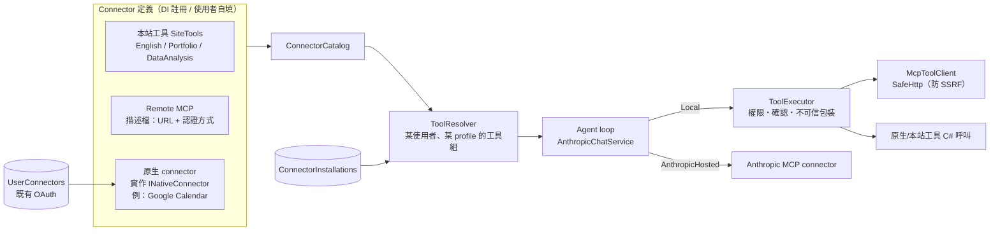
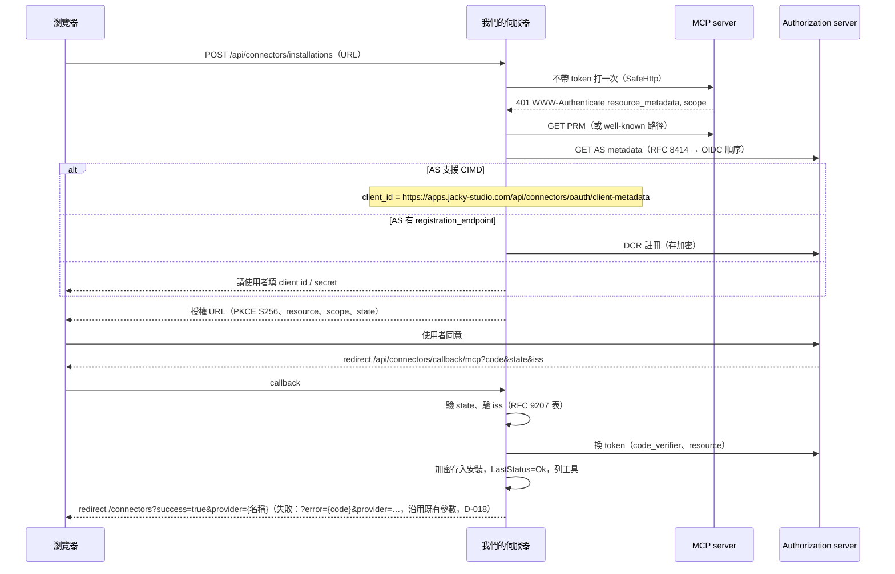

# 03 — Connector 架構

> 目標：任何數位化的東西都能變成 AI 的工具；MCP 是一等公民；現有 `/connectors` 演進而來，現有連線繼續能用；新增一個 connector 不用改核心程式。

## 1. 名詞

| 名詞 | 意思 |
|---|---|
| **Connector 定義**（definition） | 「一種」connector 的描述：名稱、圖示、分類、怎麼認證、工具從哪來。程式碼裡註冊的（內建）或使用者自填的（自訂 MCP） |
| **Connector 安裝**（installation） | 某個使用者「連上」某個定義：認證資料（加密）、啟用狀態、每個工具的權限、工具清單快取、最後狀態 |
| **工具**（tool） | AI 能呼叫的一個動作：名稱、說明、JSON schema、效果（讀／寫／破壞性）、可選的顯示方式 |
| **工具來源**（tool source） | 給一個使用者在某次對話中「現在有哪些工具」的東西。每個安裝對應一個來源；本站功能也是來源 |
| **執行方式** | `Local`：我們的伺服器執行（可確認、可包裝結果）；`AnthropicHosted`：交給 Anthropic MCP connector 執行（只給可信唯讀的伺服器，例如 tw-stock） |

## 2. 三種 connector，一套抽象



### 2.1 核心介面（`Services.Connectors`，草案）

```csharp
// 一種 connector。內建的用 DI 註冊（services.AddConnector<T>() 或 AddMcpConnector(descriptor)）。
public interface IConnectorDefinition
{
    string Key { get; }                    // 穩定、小寫 kebab："tw-stock"、"google-calendar"、"site"
    ConnectorInfo Info { get; }            // 顯示名稱、說明、分類、圖示 key、文件連結、發行者
    ConnectorAuthSpec Auth { get; }        // None | ApiKey(header, prefix) | Bearer | OAuth2(...) | McpOAuth(自動探索) | ExistingProvider("Google")
    ConnectorExecution Execution { get; }  // Local | AnthropicHosted
    bool AlwaysOn { get; }                 // 本站工具：不用安裝、不能中斷
}

// remote MCP：只要一份描述，工具在執行時從 tools/list 讀
public sealed record McpConnectorDescriptor(string Key, ConnectorInfo Info, Uri ServerUrl,
    ConnectorAuthSpec Auth, ConnectorExecution Execution = ConnectorExecution.Local) : IConnectorDefinition;

// 原生 connector（或本站工具）：自己提供工具
public interface INativeConnector : IConnectorDefinition
{
    IReadOnlyList<IAiTool> Tools { get; }
}

public interface IAiTool
{
    AiToolDescriptor Descriptor { get; }   // Name, Description, InputSchema (JsonElement), Effect, Display?
    Task<AiToolResult> InvokeAsync(JsonElement input, AiToolContext context, CancellationToken ct);
}

public enum ToolEffect { Read, Write, Destructive }
public enum ToolPermission { Auto, Confirm, Disabled }

// AiToolContext：UserId、該安裝的 access token 取得器（自動 refresh）、TimeProvider、log
// AiToolResult：給模型的內容（文字/JSON）＋ 可選的 Card（generative UI，給前端畫）＋ IsError
```

- 本站工具（`site`）也是 `INativeConnector`，但每個功能模組各自提供自己的工具（`IAiTool` 實作放在該模組，例如 `Services.DataAnalysis.AiTools`），用 DI 標記「屬於 site connector」。這樣 English 的工具歸 English 模組，Assistant 只透過 DI 拿到，不引用它。
- 既有的 Google／Microsoft／Atlassian：定義的 `Auth = ExistingProvider("Google")`，token 由既有 `IConnectorService.GetAccessTokenAsync` 取得（**不搬資料、不改既有端點**）。今天沒有工具；階段 1 會附一個原生範例 connector（Google Calendar 讀取行程）證明這條路。

### 2.2 預設權限

| 條件 | 預設 |
|---|---|
| 本站工具 `Read` | Auto |
| 本站工具 `Write` | Confirm |
| `Destructive`（任何來源） | Confirm，且不能設成 Auto |
| 外部 MCP 工具，`annotations.readOnlyHint == true` | Auto |
| 外部 MCP 工具，其他 | Confirm |
| 對話已讀過外部（不可信）內容後的任何 `Write` | 一律 Confirm（不看使用者設定的 Auto），見 06 |

使用者可以在 connector 頁逐一調整（Disabled 的工具不送給模型）。

## 3. 資料表（只新增，不動現有表）

`ConnectorInstallations`（新 module **Connectors** 擁有）：

| 欄位 | 型別 | 說明 |
|---|---|---|
| Id | Guid | PK |
| UserId | string(255) | FK Users，cascade |
| DefinitionKey | string(100) | 內建定義的 key；自訂 MCP 為 `custom` |
| DisplayName | string(100) | 自訂的才需要；內建的取定義 |
| ServerUrl | string(500)? | 自訂 MCP 的 URL（canonical，無 fragment、無尾斜線） |
| AuthKind | string(20) | None / ApiKey / Bearer / OAuth |
| EncryptedSecret | string? | `TokenEncryptionService` 加密的 JSON：api key（header 名）、bearer、或 OAuth 的 access/refresh token、到期、client 註冊結果、issuer、granted scopes |
| Enabled | bool | 中斷 = false 並清掉 secret（保留工具設定） |
| ToolSettingsJson | string? | `{ "toolName": "Auto" | "Confirm" | "Disabled" }` |
| ToolsCacheJson | string? | 最後一次 `tools/list` 的名稱、說明、schema、annotations |
| ToolsFetchedAt | DateTime? | UTC |
| LastStatus | string(20) | Ok / NeedsAuth / Error / Unknown |
| LastError | string(500)? | 給擁有者看的人話（不含 token） |
| CreatedAt / UpdatedAt | DateTime | UTC |

索引：`(UserId, DefinitionKey)` **filtered unique**（`WHERE DefinitionKey <> 'custom'`），`custom` 可多筆；另一般索引 `(UserId)`。每人自訂 MCP 上限 20 個（防濫用）。

**沒有安裝列的定義**（`site` 永遠開著；既有 Google／Microsoft／Atlassian 的連線在 `UserConnectors`）：使用者第一次調整它的工具權限時，才建立一列（`AuthKind=None`、`EncryptedSecret=null`），只用來存 `ToolSettingsJson`。沒有列 = 全部用預設權限。

## 4. MCP client（`McpToolClient`）

- 用官方 `ModelContextProtocol.Core`（HTTP client transport），傳入我們的 `SafeHttp` client（06 的 SSRF 防護）。
- 能力：`ListToolsAsync`（快取在 `ToolsCacheJson`，依 `ttlMs` 或 1 小時）、`CallToolAsync`、測試連線（列工具 + 回應時間）。
- 401 → 安裝狀態 `NeedsAuth`，對話中回「請到 Connectors 重新連線」的工具錯誤（不是整輪失敗）。
- 403 `insufficient_scope` → 狀態 `NeedsAuth`，記下需要的 scope，重新授權時用聯集（step-up）。
- 呼叫逾時 30 秒；結果大小上限 100 KB（截斷並註明）。
- 若 SDK 在 CI 上有相容性問題，退路是自己寫最小的 Streamable HTTP JSON-RPC client。注意：多數公開 MCP server 仍跑 2025-06／2025-11 版（要 `initialize` 握手與 `Mcp-Session-Id`），所以退路也必須支援舊版握手，不能只做 2026-07-28 的 stateless。

## 5. 認證流程

### 5.1 免認證／API key／Bearer

使用者在新增表單填入；存 `EncryptedSecret`；每次呼叫帶上（`Authorization: Bearer` 或自訂 header）。

### 5.2 MCP OAuth（依 MCP 授權規格）



- state：沿用 `IStateService.GenerateState(userId, provider)`，provider 傳 `mcp:{installationId}`（介面不變）；PKCE verifier 與 expected issuer 存在**伺服器端**（`IMemoryCache`，10 分鐘，key 為 nonce），不放在瀏覽器。
- CIMD 文件由我們的端點提供（`client_name`、`redirect_uris`、`grant_types`、`token_endpoint_auth_method: "none"`）。這是 public client，靠 PKCE。
- refresh：取 token 時若 60 秒內到期就 refresh（每個安裝 single-flight，避免同時 refresh 兩次把 refresh token 用掉）。refresh 失敗 → `NeedsAuth`。
- callback 路由：既有 `api/connectors/callback/{provider}` 的 provider 白名單不含 `mcp`，新增一個明確的 `api/connectors/callback/mcp` 路由（ASP.NET 會優先比對字面路由），既有三個 provider 的流程完全不動。

### 5.3 既有 OAuth provider

不變。另外修兩個既有小問題（不改行為）：`CustomClientId` 註解說加密但其實沒有（只改註解）；補 `ConnectorService`／`TokenEncryptionService`／`StateService` 的單元測試（之前完全沒有）。

## 6. 讓別人容易貢獻（`CONTRIBUTING-CONNECTORS.md` 會寫）

- **加一個 remote MCP 到目錄**：在 `Services/Connectors/Catalog/BuiltInMcpConnectors.cs` 加一筆 `McpConnectorDescriptor`（key、名稱、URL、認證方式），完成。測試樣板：`CatalogTests` 自動檢查 key 唯一、URL 是 https、資訊齊全。
- **加一個原生 connector**：新增一個資料夾 `Services/Connectors/Native/<Name>/`，實作 `INativeConnector` 與數個 `IAiTool`，在 `ConnectorServiceExtensions` 一行 `services.AddNativeConnector<GoogleCalendarConnector>()`。測試樣板：`NativeConnectorTestKit`（假的 token、假的 HttpMessageHandler、驗 schema 是合法 JSON Schema、驗每個工具都有 Effect）。
- **加一個本站工具**：在該功能模組實作 `IAiTool`，`services.AddSiteTool<T>()`。同一個 TestKit。

## 7. 端點（前端已照這份實作，第 3 輪定稿；型別見 `jackyaiapp.client/src/apis/connectorsApis/types.ts`）

| 方法 | 路由 | 說明 |
|---|---|---|
| GET | `api/connectors/catalog` | `ConnectorCatalog`：`entries`（目錄，含本站工具、內建 MCP、既有 OAuth provider〔`authKind: existingProvider`，前端不在目錄重複列，用既有卡片〕，各帶 `installed`）、`installed`（我的 connector，本站工具 `alwaysOn`、還沒有列時 `id: null`）、`customLimit` |
| POST | `api/connectors/installations/probe` | body `{ serverUrl }`；**不儲存**。正規化 URL、SSRF 檢查（拒絕時 400 + 人話）、不帶 token 打一次判斷 `auth: none / apiKey / oauth`，OAuth 時附 `authorizationServer`、`registration: cimd / dcr / manual`；`serverName` 取 MCP `initialize` 的 serverInfo（有的話） |
| POST | `api/connectors/installations` | `CreateInstallationRequest`：內建（`definitionKey` = 目錄 key，不帶 URL）或自訂（`custom` + `serverUrl` + `displayName`）、`authKind`、`credentials`（`headerName`/`value` 或手填 `clientId`/`clientSecret`）。非 OAuth 時存好就測試一次並回 `InstalledConnector`（含工具）；OAuth 回 `health: needsAuth` 的 connector，前端接著呼叫 authorize |
| POST | `api/connectors/installations/{id}/authorize` | 開始 OAuth，回 `{ redirectUrl }` |
| POST | `api/connectors/installations/{id}/test` | `ConnectionTestResult`：`ok`、`latencyMs`、`error`（人話）、更新後的 `connector` |
| PUT | `api/connectors/tool-permissions` | body `{ definitionKey, installationId, toolName, permission }`；`installationId: null` = 沒有列的內建 connector（例如本站工具），伺服器第一次調整時建立列（§3）。回更新後的 `InstalledConnector`。Destructive 工具設 `auto` → 400 |
| PUT | `api/connectors/installations/{id}/enabled` | body `{ enabled }`，回 `InstalledConnector`（停用 = `health: disabled`） |
| DELETE | `api/connectors/installations/{id}` | 移除（清 secret） |
| GET | `api/connectors/callback/mcp` | OAuth 回呼 |
| GET | `api/connectors/oauth/client-metadata` | CIMD 文件（匿名） |

新端點照 server 規範回 `ServiceResult` → `{ data: … }` 信封（前端 `transformResponse` 取 `data`）；既有的 `api/connectors/status`、`{provider}/connect` 等（回原始 JSON，沒有信封）全部保留不改。

## 8. 模組（評審後修正：不能有環、直接引用才算）

| Module | Namespaces | May use |
|---|---|---|
| Connectors（新） | `Services.Connectors`（定義、目錄、安裝、`IAiTool` 等介面、`McpToolClient`、`SafeHttp`、內建 MCP 描述含 **tw-stock**） | Platform |
| Assistant（新） | `Services.Chatbot`（原屬 Finance，整個改歸這裡，namespace 不改名以減少變動）、`Services.Assistant`（profile 介面、agent loop、`StudioChatProfile`、`site` connector 的彙整） | Connectors, Platform |
| Finance | 原有 + `Services.Finance.Assistant`（`FinanceChatProfile`、`MarketBackground` 從 Chatbot 搬來，因為它用 MarketData） | Assistant, Connectors, MarketData, Platform |
| DataAnalysis | 原有 + `Services.DataAnalysis.Assistant`（`DataAnalysisChatProfile`、data-analysis 工具） | Assistant, Connectors, Platform |
| English / Portfolio | 原有 + `*.AiTools` | Connectors, Platform |

- tw-stock 的 URL、beta、`AlwaysLoadedTools` 搬到 Connectors 的 `TwStockMcp`（內建描述，`Execution = AnthropicHosted`），Finance 與 Studio profile 都引用它，Assistant 不必引用 Finance。
- 本站工具：各模組實作 `IAiTool`，用 `services.AddSiteTool<T>(group)` 註冊；Assistant 的 `SiteToolSource` 從 DI 拿 `IEnumerable<SiteToolRegistration>`，不引用任何功能模組。
- `ChatConversations` / `ChatMessages` / `ChatAttachments` 改由 Assistant 擁有（`TableOwners` 更新）；`ConnectorInstallations` 歸 Connectors；`UserConnectors` 仍歸 Platform（不搬）。
- 這張表同步寫進 server `CLAUDE.md` 的 Modules 表（實作時）。

## 9. 本站對外的 MCP server（第 8 輪，M4 延伸）

反過來：讓 Claude Desktop、Claude Code、Cursor、VS Code 等「別人的 AI」用本站的工具——網站本身就是一個 MCP server。

- **端點** `POST /api/mcp`（`SiteMcpController` → `ISiteMcpServer`，`Services/Connectors/SiteMcp`）：Streamable HTTP、**沒有 session**，每個 POST 一則 JSON-RPC、回 `application/json`（規格允許不用 SSE）；通知回 202。方法：`initialize`（回 client 要的協定版本 2025-11-25／06-18／03-26，否則最新的）、`ping`、`tools/list`、`tools/call`。GET／DELETE 回 405。不收 batch（2025-06-18 起規格已移除）。檢查 `Origin`（有就必須同源，防 DNS rebinding）。
- **認證**：個人存取 token（PAT），`Authorization: Bearer jsk_…`。驗證方案 `SiteToken` **只**掛在這個端點（`[Authorize(AuthenticationSchemes = …)]`）：這裡不讀 cookie（別的網站無法借使用者的瀏覽器呼叫），其他端點也不收 token（token 不能拿來產生 token）。principal 帶跟 cookie 一樣的 `NameIdentifier`，所以 `ICurrentUser` 與所有服務照常運作。token 是 `jsk_` + 32 bytes base64url，表 `SiteAccessTokens` 只存 SHA-256；可撤銷（刪列）、30／90／365 天、每人 10 個、最後使用時間每分鐘最多寫一次。Claude.ai、ChatGPT 這類只用 OAuth 的 client 走 §9.1。
- **提供哪些工具**：所有 `ISiteTool`（字典、單字庫、學習進度、投資組合、Google 日曆），扣掉使用者在 /connectors「本站功能」停用的；讀取一律提供，**寫入只給建立時勾了「允許寫入」的 token**，無法復原的永遠不給。外部 client 沒有本站的確認卡，所以寫入由對方 AI 自己的確認把關，預設 token 唯讀。不提供的工具呼叫時回「Unknown tool」（不透露存在）。工具的 `annotations` 帶 `readOnlyHint`、`destructiveHint`、`openWorldHint`（`OutsideText`）。
- **其他**：每個工具 30 秒逾時、結果最多 40k 字、例外不回內文；每個 token 每分鐘 120 次（rate limiter `site-mcp`）；工具在本站不產生 AI 費用（對方的模型自己付），所以不經 usage limit；`AiToolContext.ConversationId` 是 `mcp:{tokenId}`。
- **管理** `api/connectors/site-tokens`（GET 清單、POST 產生〔只回一次 token〕、DELETE 撤銷），在 /connectors 的「讓其他 AI 使用本站」：伺服器網址、token 清單、產生後一鍵複製 Claude Code 指令、Claude Desktop（經 `mcp-remote`）、Cursor、VS Code 的設定。
- **測試**：`SiteMcpServerTests` 除了協定與工具篩選，還用官方 SDK 的 client（`McpToolClient`）端對端打這個 server。

### 9.1 本站當 OAuth 授權伺服器（同一輪後半）

讓「貼上網址 → 登入 → 完成」的 client（Claude.ai 自訂 connector、ChatGPT、照 MCP 授權規格的任何 client）也能用：

- `GET /.well-known/oauth-protected-resource`（與 `/api/mcp` 的 path-inserted 版本）：`resource` = `{issuer}/api/mcp`、`authorization_servers` = `[issuer]`、scope `mcp:read`／`mcp:write`。`/api/mcp` 的 401 帶 `resource_metadata`。
- `GET /.well-known/oauth-authorization-server`：authorize = `{issuer}/oauth/authorize`（前端頁面）、token、registration、只有 `code`、`authorization_code`、`none`（public client）、PKCE `S256`、`authorization_response_iss_parameter_supported`。issuer 是 `Connectors:CallbackBaseUrl` 的 origin（沒設定時用請求的 origin）。
- **DCR 不用資料表**（`SiteOAuthClients`）：client_id 就是 `{名稱, redirect URIs}` 經 ASP.NET Core data protection 加密簽章後的字串，讀回來即可；redirect 只能 https 或 http 的 loopback。金鑰換了 client_id 就失效，client 會重新註冊。
- **同意頁** `/oauth/authorize`（`OAuthConsent`）：未登入先用 Google 登入並帶著完整 query 回來；`GET api/oauth/consent` 檢查 client、redirect（不在註冊清單就停在本站，不導回，防 open redirect）、`response_type=code`、PKCE S256、`resource`；顯示「誰、回到哪個網站、可否寫入」。寫入與否是**使用者**勾的，不是 client 要的 scope。`POST api/oauth/consent` 產生授權碼（記憶體 5 分鐘、一次性）並回 `redirect_uri?code&state&iss`，拒絕則 `error=access_denied`。
- **token** `POST /api/oauth/token`（form）：授權碼第一次嘗試就作廢（就算後面的檢查失敗）、client 與 redirect 必須相同、PKCE、`resource`；發的 access token 就是一個 PAT（以 client 名稱命名、90 天），所以 /connectors 的清單看得到、可撤銷。沒有 refresh token：到期後 client 重新請使用者授權。
- 測試：`SiteOAuthServerTests` 走完註冊 → 同意 → 換 token → MCP server 收下 token，以及每一關的拒絕。
- 第 9 輪：`register`、`token` 兩個匿名端點加 rate limit（`site-oauth`，每個位址每分鐘 30 次，位址取 `CF-Connecting-IP`，因為正式站只收 Cloudflare 的流量，D-049），被擋時回 OAuth 的錯誤格式；OAuth 發的 token 標 `ViaOAuth`，/connectors 的清單顯示「經 OAuth 登入」。

### 9.2 本站是 MCP App（第 9 輪）

MCP Apps 擴充（`io.modelcontextprotocol/ui`）讓支援的 client（Claude、ChatGPT）在回答下方用 sandboxed iframe 畫 server 提供的 UI。本站用它把工具的卡片（站內 chat 裡的表格、連結卡）原樣帶到別家的 AI 裡：

- **一個 app 畫所有卡片**（`SiteMcpApp`）：資源 `ui://jacky-studio/card.html`，`text/html;profile=mcp-app`，script 與 style 全部內嵌（不需要任何外部網域，host 預設的 CSP 就夠），只用 `textContent` 寫值（不用 innerHTML），連結只經 host 的 `ui/open-link`、只到 https。跟 host 的 `hostContext.theme` 切深淺色，內容高度用 `ui/notifications/size-changed` 回報。
- **宣告**：`initialize` 的 capabilities 有 `resources` 與 `extensions["io.modelcontextprotocol/ui"].mimeTypes`；`tools/list` 每個工具帶 `_meta.ui.resourceUri`；`resources/list`、`resources/read`（其他 uri → -32002）。server 沒有 session，看不到 client 在 initialize 有沒有宣告支援，所以一律提供（D-050）：不支援的 client 會忽略 `_meta` 與 `structuredContent`。
- **資料**：`tools/call` 成功且工具有卡片時，結果多一個 `structuredContent: { card }`——table 原樣，link 的 `href` 補成完整網址（本站路徑 → issuer + 路徑；只收 https）；其他 kind、不能跟的連結、超過 200k 字元則不放。文字（`content`）照舊，連結卡另外在文字後附「標題：完整網址」，讓不畫 app 的 client 也能給使用者連結。
- **按鈕（第 10 輪，D-059）**：工具實作 `IOffersAppActions` 就能在卡片上放「下一步」（查字典 → 加入單字庫），`structuredContent.actions: [{ tool, label, arguments }]`，只放這個 token 能呼叫的；App 按下時送 `tools/call` 給 host，host 轉給本站。使用者按下就是確認。
- **測試**：`SiteMcpServerTests` 的 MCP Apps 區塊（宣告、資源、structuredContent、HTML 不含 innerHTML 與外部載入）；畫面用 playwright 自己扮 host（`ui/initialize` → `tool-result` → `size-changed`）截圖（`screenshots/mcp-app-card-*.png`），含 `` 當資料時只顯示成文字。
